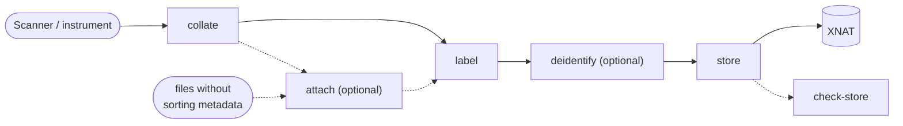

<p>
  <br>
  <picture>
    <source media="(prefers-color-scheme: dark)" srcset="https://raw.githubusercontent.com/Australian-Imaging-Service/accessionflow/main/docs/logo_dev/accessionflow-logo-dark.png">
    
  </picture>
  <br>
  <br>
</p>

[](https://github.com/Australian-Imaging-Service/accessionflow/actions/workflows/ci-cd.yml)
[](https://codecov.io/gh/Australian-Imaging-Service/accessionflow)
[](https://pypi.python.org/pypi/accessionflow/)
[](https://australian-imaging-service.github.io/accessionflow/)


Accessioning is the process of formally receiving material from a source and registering
it in a managed collection. AccessionFlow is a
collection of tools to accession data: collate, label, de-identify and store them
in a data store. Support for various file types is provided through
the [FileFormats](https://arcanaframework.github.io/fileformats/) package and its extensions
(e.g. [FileFormats MedImage](https://arcanaframework.github.io/fileformats-medimage/), [FileFormats Siemens](https://arcanaframework.github.io/fileformats-vendor-siemens/),...).




## Installation

A Docker image containing the toolkit can be pulled from the GitHub Container Registry
and entrypoint of the image is the accessionflow CLI so commands can be run by the form

```
docker run ghcr.io/australian-imaging-service/accessionflow:latest <command-name> <arg1> <arg2> ... --opt1 <opt1> ...
```

Alternatively, AccessionFlow can be installed as a Python package from PyPI with `pip`:

```
$ python3 -m pip install accessionflow
```


## Running

AccessionFlow has a public API and a command-line interface (CLI), with sub-commands to collate, label,
attach, de-identify, and upload imaging sessions to XNAT — either as a one-off run or as a
continuously-running service (e.g. via Docker Compose or Kubernetes).

See the [full documentation](https://australian-imaging-service.github.io/accessionflow/) for a hands-on
quick start, how-to guides for each part of the pipeline, and the complete CLI/API reference.
